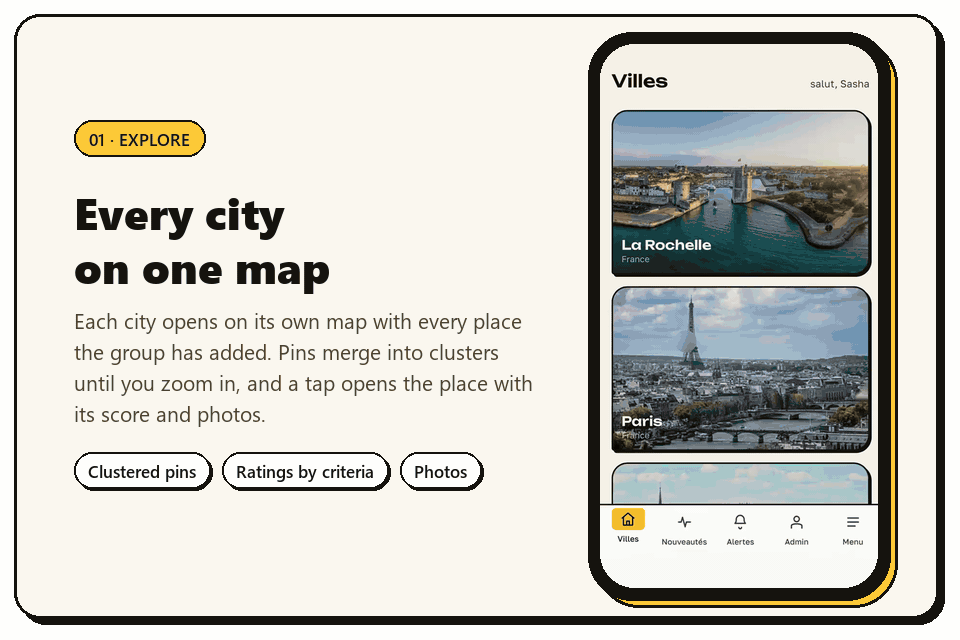
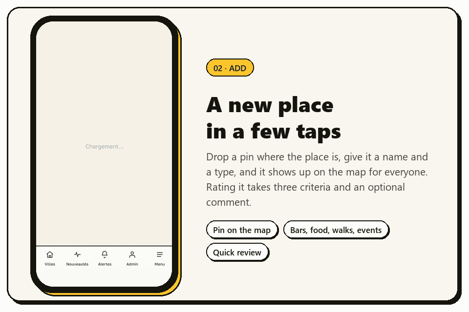
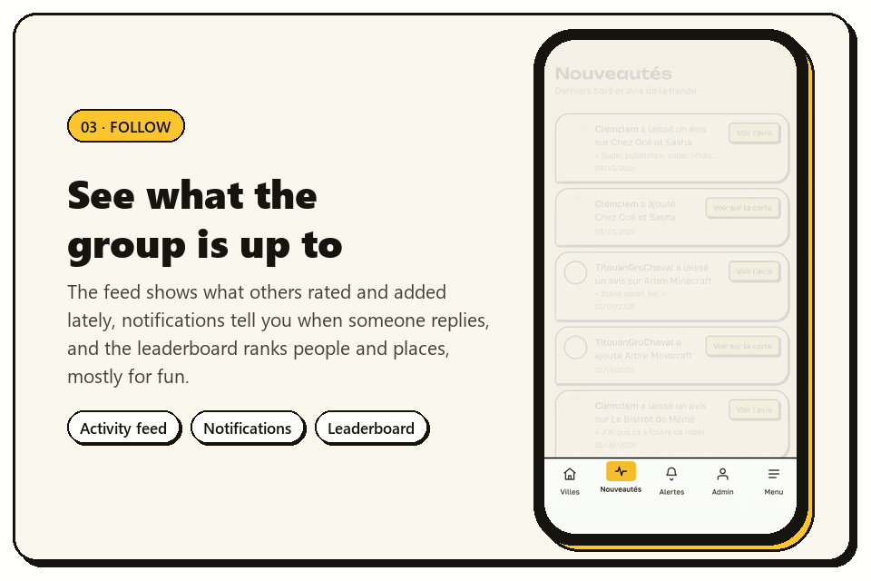
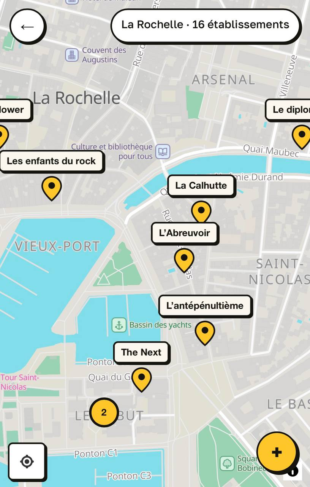
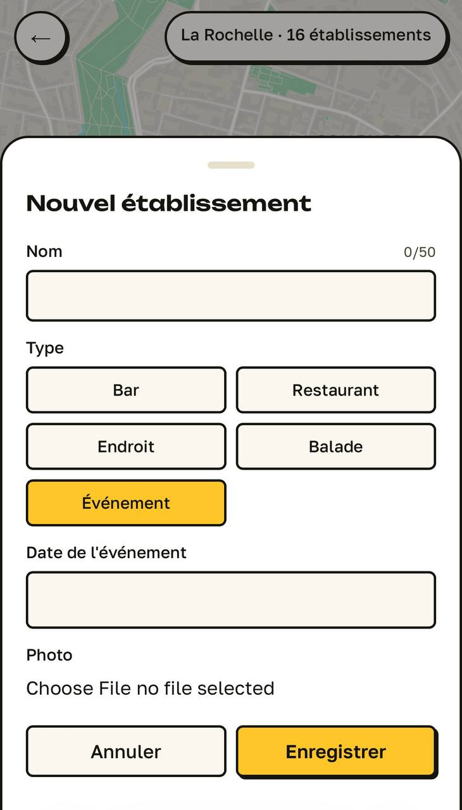
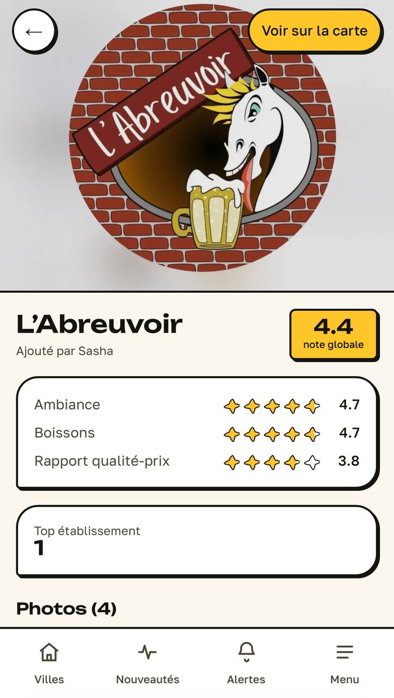
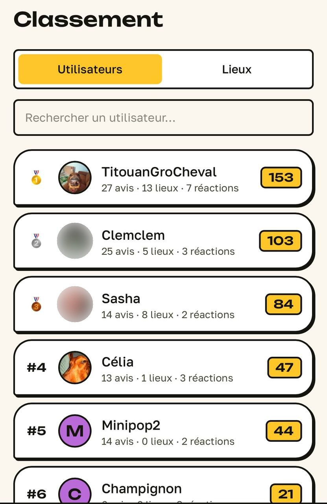
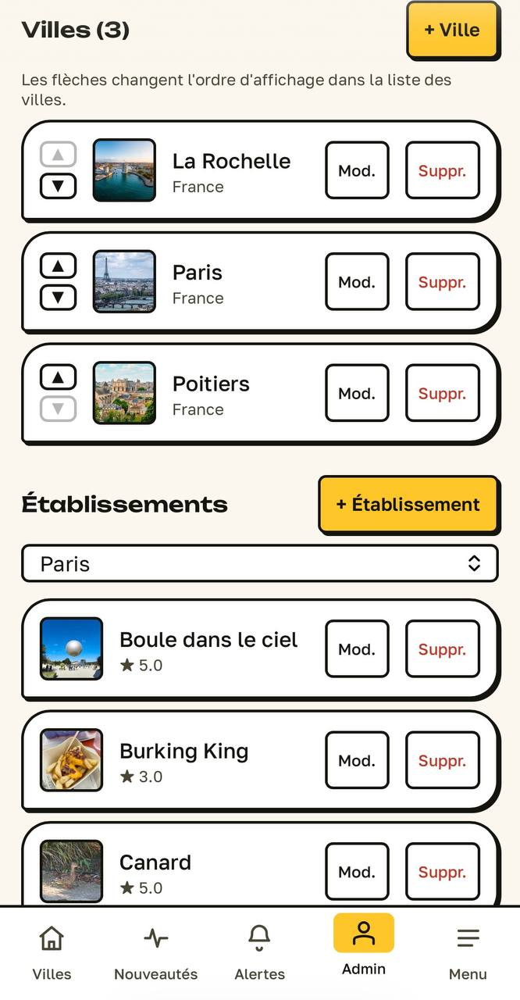
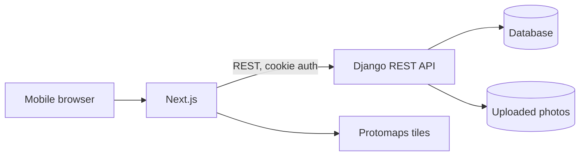

# 🍺 theBarathon

A mobile web app for rating bars, restaurants and other places worth going back to.


## 📖 About

The project started during a barathon: a night of going from bar to bar, where we
wanted a quick way to score each place before moving on to the next one. It turned
out to be useful beyond that night, so it grew into a small mobile web app that we
now use for every bar, restaurant, walk or event we go to. My friends and people
around them use it regularly, and that is what keeps the project going.

## 💡 Why I built it

Most apps in this space are either full of ads or become paid once a group grows
past a handful of people. Public review platforms have another problem: a low score
there can hurt a business that is perfectly fine, just not to our taste. Here the
ratings stay within the group, so everyone can be honest about what they actually
liked.

I also wanted the interface to stay small. Opening the app, finding a place on the
map and leaving a rating should take seconds, without extra sign-up steps and
without handing personal data to a service that makes money from it.

## 🎬 A quick tour

<p align="center"></p>
<p align="center"></p>
<p align="center"></p>

## ✨ Features

Places are added directly on the map and can be a bar, a restaurant, a walk or an
event. Each place collects reviews with a rating, the amount spent and photos, and
reviews can be discussed in threaded comments with reactions.

<p align="center">
  
  
  
</p>

On top of that there is a vote for the best places, a leaderboard of people and
places, an activity feed and notifications for replies. Admins manage users and
cities, and registration can be limited to an invite code. Everything runs in the
phone's browser, so there is nothing to install.

<p align="center">
  
  
</p>

## 🧰 Tech stack

| Layer | Technology |
|---|---|
| Backend | Django, Django REST Framework |
| Frontend | Next.js, React, TypeScript, Tailwind CSS |
| Map | MapLibre GL with self-hosted Protomaps tiles |
| Auth | JWT stored in httpOnly cookies |
| Database | SQLite / PostgreSQL / MySQL (through the Django ORM) |
| Hosting | VPS, gunicorn, pm2 |

## 🧠 Technical decisions

**Self-hosted map tiles.** The map runs on Protomaps tiles served from my own
server. There is no dependency on Google Maps or Mapbox, no API keys and no usage
limits to worry about.

**Tokens in httpOnly cookies.** The frontend never reads the JWT; the browser sends
it with each request. A script injected into the page can't steal the session the
way it could with a token in `localStorage`.

**Invite-only as a setting.** Registration currently requires an invite code, mainly
to keep strangers away from our data while there is no moderation. Once moderation
is ready, I'll open registration to everyone.

**Mobile first.** The app is used on the way to a place or while sitting in it, so
every screen is designed for a phone and the desktop layout comes second.

## 🏗️ Architecture



```
theBarathon/
├── backend/    Django REST API: auth, places, reviews, comments, admin
└── frontend/   Next.js client: pages, map
```

## 💻 Running locally

More details in [`backend/README.md`](backend/README.md) (admin, invite code,
environment variables) and [`frontend/README.md`](frontend/README.md). The map
needs a tiles file that isn't in the repo; the frontend README explains how to
generate it.

Two terminals:

```bash
# 1) backend
cd backend
python -m venv venv && source venv/Scripts/activate
pip install -r requirements.txt
python manage.py migrate
python manage.py createsuperuser
python manage.py runserver localhost:8000

# 2) frontend
cd frontend
npm install
npm run dev
```

Open `http://localhost:3000`, log in with the superuser and open `/admin` in the
app to get the invite code for other accounts.

## 🛠️ How I work

I design the architecture, pick the stack and work out the interface myself before
any code is written. AI is part of my workflow as a coding assistant: I give it
well-defined pieces of work, review what comes back and use it to write unit tests.
Frontend testing happens by hand on real phones. Deployment I handle myself: a Linux
VPS with gunicorn serving the Django API, the Next.js production build, and pm2
keeping both processes running and restarting them on failure.

## 🗺️ Roadmap

- [x] Places on a map, reviews with photos, comments and reactions
- [x] Voting for the best places, leaderboards, activity feed and notifications
- [ ] Moderation of text and photos, partly automated with AI
- [ ] Content Security Policy before opening registration to the public
- [ ] Open registration for everyone once moderation is tested
- [ ] Groups, public or private, each with its own places on the map
- [ ] Recommendations based on RAG that suggest places from a person's or a group's ratings and activity

## 📬 Contact

[LinkedIn](https://www.linkedin.com/in/aleksandr-kuznetsov-018006358/) · [doggoz01@proton.me](mailto:doggoz01@proton.me)

## 📄 License

[PolyForm Noncommercial 1.0.0](LICENSE): free for personal and other noncommercial use. Selling the code or using it in a commercial product is not allowed.
